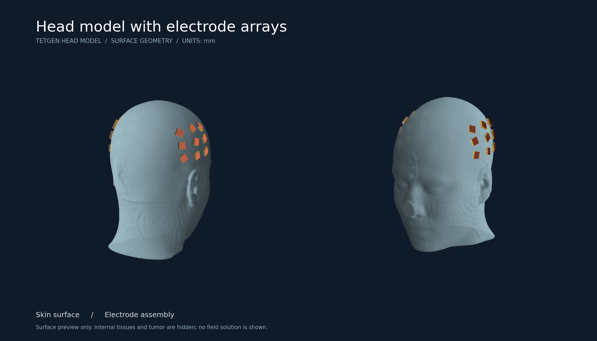
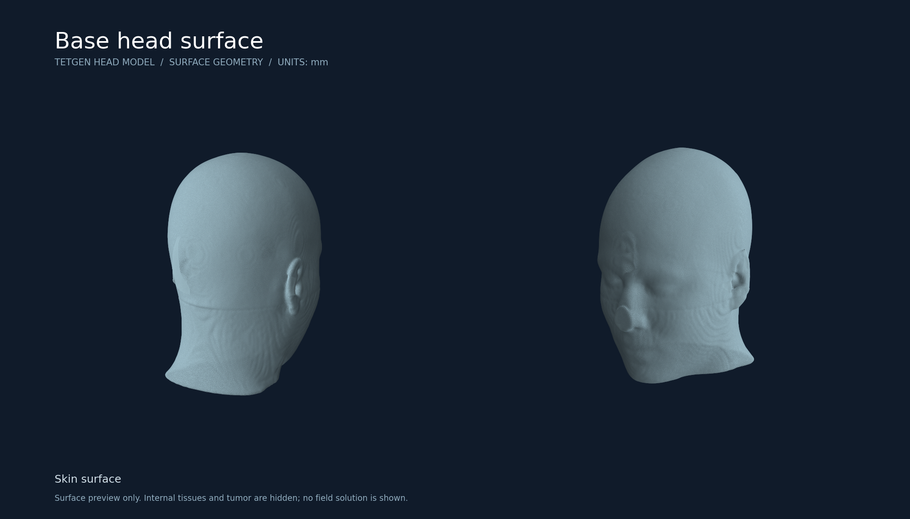

# 3D Human Head Model for TetGen

Prepare head, tumor, and scalp-electrode geometry for tetrahedral meshing.

This repository preserves a research project developed in **2020–2021**, with
an English documentation and packaging refresh in 2026. The original work builds
electrode assemblies on a triangulated head surface, connects their hydrogel
layers to the scalp, and exports a piecewise linear complex (PLC) for TetGen.



*Actual surface geometry from a saved 2021 export. Colors distinguish the skin
and electrode assembly. Internal tissues and tumor layers are hidden in this
view; this is not an electric-field simulation.*

The square-looking electrodes in this saved example are a coarse polygonal
approximation of a circular electrode. Increasing the circumference resolution
makes the outline closer to a circle; see [electrode shape resolution](#electrode-shape-resolution).

## What is included

- A marked, multi-surface head model and a historical electrode example.
- An experimental interactive editor retaining the original geometry routines.
- Two concentric spherical tumor surfaces with configurable location and radii.
- Hydrogel, ceramic, and electrode layers aligned to local skin normals.
- Single-electrode placement and paired arrays based on nine-point layouts.
- A command-line inspector and reproducible PNG previews.

TetGen performs the subsequent volume meshing separately. This Python package
does not calculate electric fields, assign electrical material properties, or
implement a treatment-planning solver.

## Quick start

Use Python 3.10 or later. From the repository root:

```bash
python -m pip install -e .
python -m head_model.cli inspect data/mni4.poly.gz
python -m head_model.cli render data/electrode-example.poly.gz --output outputs/electrodes.png --title "Head model with electrode arrays"
```

The compressed sample files are read directly; no separate download is needed.
The installed `head-model` command is equivalent to `python -m head_model.cli`.

### Preview the base head

```bash
head-model render data/mni4.poly.gz --output outputs/head.png --title "Base head surface"
```



Previews show all skin triangles in the supplied examples. For larger surfaces,
the renderer uses deterministic sampling above 300,000 skin triangles.
All electrode facets are shown. Display sampling does not modify the source model.

### Open the research editor

```bash
head-model edit data/mni4.poly.gz --output-dir outputs/session --single
```

Use a desktop Matplotlib backend. Rotate the view, then right-double-click a
location to invoke the original placement workflow. Omit `--single` to use the
paired-array mode. Successful placement writes `head-electrodes.poly` and
`contact-points.node` in the selected directory; subsequent placements overwrite
those files with the current model. Choose a new output directory for each session.

**The editor is experimental.** Its original screen-coordinate picking and
surface-stitching algorithms are retained. They can fail for some views, locations,
or mesh configurations. Inspect the exported geometry before meshing. The saved
example above is historical output, not a claim that the refreshed editor
reproduces that placement end to end.

### Mesh with TetGen

Install TetGen separately, then run it on an exported PLC, for example:

```bash
tetgen -pA outputs/session/head-electrodes.poly
```

This is a starting command, not a quality guarantee. Inspect boundary consistency,
region definitions, intersections, and element quality for your intended analysis.
The refresh does not bundle third-party executables or run an electric-field solve.

## Geometry parameters

The historical defaults are in `_initialize()` in `head_model/editor.py`.
Coordinates and dimensions are interpreted in millimeters.

| Parameter | Default | Meaning |
| --- | ---: | --- |
| `s` | 3.0 | Hydrogel offset from the skin |
| `d_1` | 0.2 | Ceramic thickness |
| `d_2` | 1.0 | Electrode thickness |
| `a` | 9.0 | Electrode radius |
| `div_c` | 10 | Circumference samples, including the repeated endpoint |
| `r_1`, `r_2` | 5.0, 4.0 | Outer and inner tumor radii |
| `center_x, center_y, center_z` | 33, -45, 23 | Tumor center |
| `div_t`, `div_tz` | 30, 30 | Tumor angular and axial sampling |

### Electrode shape resolution

The electrode outline is constructed by sampling a circle of radius `a` and
connecting adjacent samples with straight edges. A small number of edges gives
a polygonal outline, such as a square; more edges produce a closer approximation
to a circular electrode. This controls the shape of each electrode, independently
of how many electrodes are placed in an array.

Set `div_c` in `_initialize()` in `head_model/editor.py`. The implementation uses
`np.linspace(0, 2 * np.pi, div_c)`, including both endpoints. Since the first and
last samples coincide, **the number of distinct perimeter edges is `div_c - 1`**.

| `div_c` | Perimeter edges | Outline |
| ---: | ---: | --- |
| 5 | 4 | Square |
| 10 | 9 | Nine-sided polygon (current editor default) |
| 17 | 16 | Finer approximation of a circle |
| 33 | 32 | Near-circular polygon |

For example, set `div_c = 33` for 32 perimeter edges, then restart the editor and
generate a new model. Keep `a` unchanged to retain the same circumradius; polygon
area approaches the area of the circle as the resolution increases. More samples
also add vertices and facets and increase the surface-stitching workload.

Changing this setting does not alter the bundled historical export or its PNG
previews. Those show the geometry saved at the time; a rounder example requires
newly generated electrode geometry.

## Repository layout

```text
head_model/
  cli.py          Inspection, rendering, and editor commands
  poly.py         ASCII PLC reader with point-ID validation
  render.py       Deterministic two-view surface previews
  editor.py       Preserved research geometry routines and GUI entry point
data/
  mni4.poly.gz             Multi-surface input head
  electrode-example.poly.gz  Saved historical electrode model
docs/
  algorithm.md    Workflow, maintenance notes, and known limitations
  images/         Generated example figures
tests/            Reader regression tests
```

See [data provenance](data/README.md) for sample origins and checksums, and
[algorithm notes](docs/algorithm.md) for the preservation scope.

## Validation

```bash
python -m unittest discover -s tests -v
```

The refresh checks parsing of both supplied full models, reader edge cases,
headless editor initialization, and image generation. Interactive electrode
placement and a fresh TetGen volume mesh are not covered by these checks.

## Historical source and reuse

The original scripts, including their original filenames and comments, remain in
[Git history at revision 1faf827](https://github.com/rldydgk2/3d-human-head-model-by-tetgen/tree/1faf827).
The current editor is derived from that revision's latest research script.
Earlier experiments and duplicate text snapshots were removed from the current
tree to make the maintained entry point clear.

No new license is asserted for the research code or anatomical data in this
refresh. Check the original data provenance and applicable permissions before
redistribution or downstream use.
